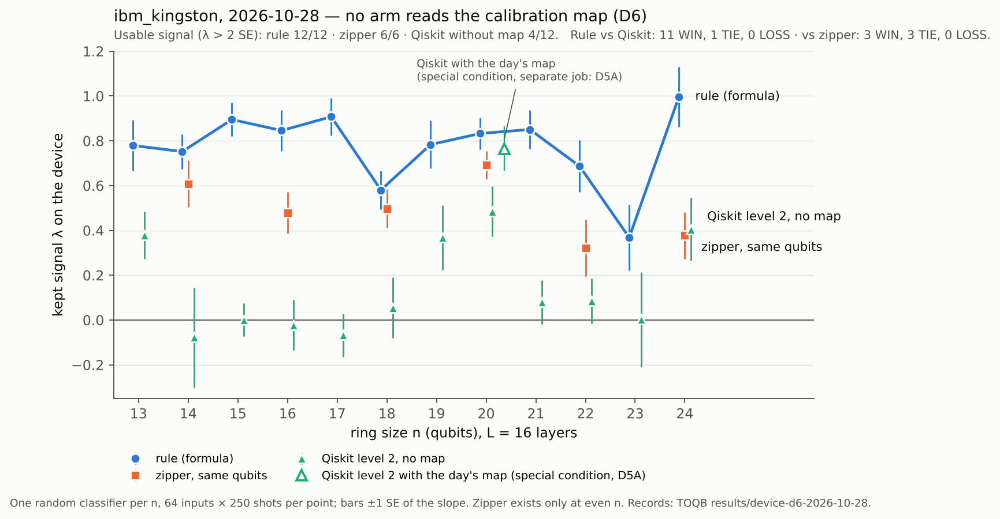

# PSF-Zero: a quantum compiler that builds circuits by formula

[](https://www.gnu.org/licenses/agpl-3.0)
[](https://www.python.org/downloads/)
[](https://github.com/qiskit/ecosystem)
[](https://www.rust-lang.org/)
[](https://pyo3.rs/)
[](https://doi.org/10.5281/zenodo.22977930)
[](https://doi.org/10.5281/zenodo.22978090)
[](https://doi.org/10.5281/zenodo.23826596)
[](https://doi.org/10.5281/zenodo.23706881)
[](https://doi.org/10.5281/zenodo.23826351)

PSF-Zero is a Qiskit-compatible compiler for IBM devices that builds a circuit by formula: no layout search, no
routing search, and no choice by the day's error values. What it cannot build by formula it refuses with a reason.
Every result below is given twice, as the benchmark custom would quote it and as someone running it on a device would
need it; predictions are locked in git before each scored run, and losses are published next to wins.

## Headline: on the device, without the calibration map (2026-10-28)



On ibm_kingston, ring classifiers of n = 13-24 qubits (16 layers) were compiled three ways, and no compiler was given
the day's error rates; each was told only which elements had failed. The device then measured how much of each
circuit's noiseless output survived (λ).

- **Benchmark number:** PSF-Zero's formula ring beat Qiskit level 2 at 11 of 12 sizes (1 tie, 0 losses), and the
  zipper on the same qubits at 3 of 6 (3 ties, 0 losses).
- **Device user's number:**
  - Without the map, Qiskit kept no usable signal at 8 of 12 sizes. Its circuits ran 22-108 µs, against 5.6-9.3 µs.
  - Given the day's map, a special condition run as a separate job at n = 20, Qiskit came within error of the formula
    ring: 0.77 against 0.94, not decided.
  - The formula reads no map, so its result does not age as the calibration does.

One classifier per size, one device, one day; predictions were locked before the run, and both missed in part (see the
records). Records: TOQB `results/device-d6-2026-10-28` and `results/device-d5a-2026-10-28`.

## What it does

- **`compile_for_hardware(qc, backend=...)`** builds every circuit whose two-qubit interaction graph embeds in the
  device (chains, rings, lattices, embeddable graphs) on heavy-hex CZ devices (IBM Heron) and ECR devices (IBM Eagle),
  in a time-aware gate order, with IBM's native `rzz` / `rx` where offered, on working qubits and couplers only.
  Every other circuit, and every call without the device, raises `OutOfScopeError`.
- **`compile_template(qc, target)`** builds once and binds new angles in about a millisecond, for training loops
  (CZ devices).
- **Ring classifiers that do not embed** (the AI front end, `patches/psf_ai_compile_a26_2026-10-26/`): the ring is
  folded onto one of the device's own cycles (12, 20, 24, ... qubits) by formula, its extra nodes hung off a shorter
  cycle (**n + (n - m) two-qubit gates per layer, on exactly n qubits**; 14 at n = 13) or a longer cycle's spare
  qubits moved as holes (n + 2 (m - n)); the fewest extra gates decides, and for small rings (n = 4-7) the ring is
  laid on a line with a fixed schedule (with `PSF_RING_ZIP=1` the **zipper**, 5n/2 - 4 or (5n - 7)/2 CZ per layer).
  `PSF_RING_FOLD=0` gives the earlier front end a25.

## Results

| | what the benchmark custom quotes | what a device user should also know |
| :--- | :--- | :--- |
| Ising chains built by formula (real devices, 2026-10-12 to 14) | PSF-Zero's side won 19 of 23 pairs, fidelity ratio 1.21 (geometric mean) | worst pair 0.94; pairs repeat tests across three devices, so they are not independent |
| Time-aware gate order (two pre-registered tests, two devices) | fidelity 1.17-1.51 x higher, 8 of 8 | the same gates, only reordered |
| QAOA and Barabasi-Albert graphs, where placement decides | **lost**: 9 of 25 pairs, ratio 0.78 | left to search-based compilers; our losing data are published |
| General circuits (880 Benchpress tests, release 2026-10-07.1) | about level with Qiskit level 2: 1.046 x its two-qubit gates | 3.5 x its compile time; out of scope since 2026-10-16.1 |
| The zipper's CZ count | no cheaper schedule found: from every start layout for n = 4-10, from the minimum-length ones at n = 12, 14 | an exhaustive search, not a proof for every n ([TOQB](https://github.com/TN-Holdings-LLC/TOQB/tree/main/results/zipper-bound-2026-10-24)) |
| A trained ring classifier, zipper (formula) against Qiskit (search), Paper 3 | a third fewer CZ, a quarter of the duration (336 against 506 CZ, 11.7 against 48.2 us at 16 layers) | the declared tests could not tell the two classifiers apart: no win either way |
| Ring folded onto a device cycle against the zipper (declared matches on TOQB's twins, n = 13-18, 16 layers, four random models each) | WIN at every n on both twins; about half the zipper's two-qubit gates, shorter | on the twin of a real day's calibration (ibm_kingston, 2026-10-24) the lead is 1.07-1.28 x the zipper's signal at n = 13-17 (1.15-1.6 x fewer shots) and about even at 18 ([flow G](https://github.com/TN-Holdings-LLC/TOQB/tree/main/results/flow-g-2026-10-26)); an older snapshot's twin had shown 1.5-8.2 x, mostly its pessimism for the zipper ([flow F](https://github.com/TN-Holdings-LLC/TOQB/tree/main/results/flow-f-2026-10-26)) |
| The folded ring's first device jobs (2026-10-26, n = 13, 64 inputs x 250 shots, 7 s each) | kept its signal as each day's twin predicted: ibm_kingston 0.90 +- 0.12 against 0.77, ibm_fez 0.50 +- 0.10 against 0.59 | one job per device, one random model; coarse tests that rule out a large loss, not a difference of 0.1; no zipper on a device ([D1](https://github.com/TN-Holdings-LLC/TOQB/tree/main/results/device-d1-2026-10-26), [D2](https://github.com/TN-Holdings-LLC/TOQB/tree/main/results/device-d2-2026-10-26)) |
| Folded ring against Qiskit's search (level 2 on the day's Target, the same twin and models, n = 13-16 and 18) | WIN on every model (20 of 20); 1.8-3.0 x fewer two-qubit gates, 5-10 x shorter | the rule kept 0.61-0.82 of the signal, Qiskit's circuits -0.05-0.64 (below 0.3 on 14 of 20 models); 1.6-57 x fewer shots where Qiskit's signal is positive; one Qiskit setting, twin only ([flow I](https://github.com/TN-Holdings-LLC/TOQB/tree/main/results/flow-i-2026-10-26)) |
| Same classifiers, same qubits, only the schedule changed (n = 18, 20) | the rule against the zipper laid on the same qubits: WIN 4/4 at both n | the bare ring kept 1.44-1.81 x the zipper's signal, two holes 1.13-1.20 x; twin only ([flow K](https://github.com/TN-Holdings-LLC/TOQB/tree/main/results/flow-k-2026-10-27)) |
| Larger rings (the rule alone, n = 20, 22, 24) | 320, 384, 384 two-qubit gates (the zipper's: 736, 816, 896) | kept 0.78-0.86, 0.75-0.84, 0.81-0.83 of the signal; on one 20-cycle two pendants kept nearly what the bare ring kept and more than two holes (0.61-0.68); twin only ([flow J](https://github.com/TN-Holdings-LLC/TOQB/tree/main/results/flow-j-2026-10-27)) |
| One hardware job, ibm_kingston, 2026-10-24 | the zipper's circuits followed a twin of that day's calibration: scale 1.00, correlation 0.98 | one job, 90 points of one label; Qiskit's circuits in the same job lost most of their signal and came out inverted, cause not found |

Details: [Scope](#scope-where-psf-zero-competes), [Where it is weaker](#where-it-is-weaker), and the test bench
[TOQB](https://github.com/TN-Holdings-LLC/TOQB) for every ring and training result.

**Not yet known:** the folded rings' signal above n = 24 (their gate counts, 0.42-0.47 of the zipper's at n = 20-30,
are; [TOQB](https://github.com/TN-Holdings-LLC/TOQB/tree/main/results/rule-big-2026-10-26)), and the folded ring
against the zipper on a device (one folded-ring job per device so far, above). All signal comparisons above are on
noise models of one day's calibration with random classifiers.

## Current version

**`psf_compile.py` 2026-10-18.1** (chains and even rings through psfz, PSF-Zero's compiler in Rust, when built) and
the AI front end **a26** (2026-10-26: rings folded onto device cycles by default; `PSF_RING_FOLD=0` gives a25's
output, bit for bit). Every release
and dated notice, newest first: [`docs/RELEASES.md`](docs/RELEASES.md). The changelog of `psf_compile`:
[`docs/psf_compile_CHANGELOG.md`](docs/psf_compile_CHANGELOG.md).

> **If you use a release from 2026-10-03.1 to 2026-10-04.1 on a cx device, update:** with `final_resynthesis` or
> `compare_level3` those could return a circuit not equivalent to the input (fixed in 2026-10-05.1; see
> [`docs/RELEASES.md`](docs/RELEASES.md)).

## Install

```bash
git clone https://github.com/TN-Holdings-LLC/psf-zero.git
cd psf-zero
pip install -e .            # the Python package (psf_compile.py), numpy, scipy, networkx, qiskit==2.5.2
maturin develop --release   # the Rust core (src/lib.rs, psf_zero_core) -- must run LAST
cargo build --release --manifest-path rust/psfz/Cargo.toml      # psfz: chains and rings in Rust (optional)
cargo build --release --manifest-path rust/psfbind/Cargo.toml   # psfbind ring r3: needed by the AI front end (a25, a26)
python benchmarks/check_core_build.py   # prints RESULT: OK if the core has every function the Python code calls
```

The order matters: with both `Cargo.toml` and `pyproject.toml` in one folder, running `maturin develop` first builds
the wrong package, and `pip install -e .` after it undoes the core. Needs a Rust toolchain
([rustup.rs](https://rustup.rs)) and `maturin`.

## Quick start

```python
from qiskit_ibm_runtime.fake_provider import FakeMarrakesh
from psf_compile import compile_for_hardware, compile_template

backend = FakeMarrakesh()
out = compile_for_hardware(qc, backend=backend)   # OutOfScopeError if qc does not embed in the device

tpl = compile_template(qc, backend.target)        # build once ...
out = tpl.bind(qc_with_new_angles)                # ... bind per call
```

**Always give the call the device.** Real devices' Targets keep failed couplers and qubits at error 1; a call
without the device cannot avoid them, and since 2026-10-16.1 it is refused.

A ring classifier that does not embed (the AI front end, from the repository folder, with `rust/psfbind` built):

```python
import importlib.util, os
spec = importlib.util.spec_from_file_location("psf_ai_compile", "patches/psf_ai_compile_a26_2026-10-26/psf_ai_compile.py")
ai = importlib.util.module_from_spec(spec); spec.loader.exec_module(ai)
os.environ["PSF_RING_ZIP"] = "1"                   # small rings (n = 4-7): the zipper as a candidate (off by default)
tpl = ai.model_template(qc, backend.target)        # folded onto a device cycle where the rule says so, or None
out = tpl.bind(qc)
```

## Scope: where PSF-Zero competes

Declared 2026-10-14 after pooling every compiled pair run on a real device between 2026-10-12 and 2026-10-14: 54 pairs,
four runs, three devices (ibm_kingston, ibm_marrakesh, ibm_fez); the pooling was done after the fact
([Addendum 488](docs/findings/spare-qubit-cliff-combined-450.md)).

| | pairs | PSF-Zero's side won | F ratio (geometric mean) |
| :--- | :---: | :---: | :---: |
| Ising chains, built by formula | 23 | 19 | **1.21** (worst 0.94) |
| QAOA and Barabasi-Albert, compiler choices only | 25 | 9 | **0.78** |
| QAOA and Barabasi-Albert, with the device's native rzz | 6 | 5 | 1.56 |

- **Where the formula applies, PSF-Zero wins**; elsewhere placement decides the result, and placement needs search or
  calibration, which PSF-Zero does not use by design.
- **So it competes only where it can build by formula:** chains, rings and lattices on the device, and the device's
  native fractional gates. Since 2026-10-16.1 everything else is refused rather than handed to Qiskit.
- **Rings on hardware:** a ring template ran on ibm_marrakesh (2026-10-22; right shape, but the twin's scale was off
  by up to 2.3 x) and the zipper on ibm_kingston (2026-10-24), both through TOQB, one job each (Paper 3, Sections 3
  and 7.4).

## Where it is weaker

- **General circuits.** On all 880 Benchpress transpilation tests not used during development (BP-FINAL,
  pre-registered, Addenda 407-408), release 2026-10-07.1 used 1.046 times Qiskit level 2's two-qubit gates (95%
  interval 1.037-1.055; fewer on 117, as many on 314, more on 446), at a median 3.5 times its compile time; Hamiltonian
  simulation was the weakest (1.06-1.09). These circuits are out of scope since 2026-10-16.1.
- **Placement-decided families** (QAOA, Barabasi-Albert): lost on real devices, as in the Scope table.
- **Depth against TKET:** the earlier two-qubit synthesis `compile()` reached depth 9 where TKET's
  `FullPeepholeOptimise` reached 7, at 150-270 times its speed. We know no way to close that without searching.
- **Without the device**, no call can avoid failed elements: in BP-FINAL the default call, which did not read the
  Target, placed gates on failed elements in 62 of 105 FakeTorino tests.
- **Rings:** the zipper's minimality is an exhaustive search up to n = 14, not a proof; on hardware it has run in one
  job. The pendants' bound is proved only for layered schedules on the cycle and its leaves, the holes' only within
  their class (Paper 4); the signal results are on twins, not devices.

## Earlier: two-qubit synthesis, `compile()` (release 2026-10-14.1)

A closed-form Cartan (KAK) decomposition in a small Rust core: on dense two-qubit-block circuits 2.5-5 times faster
than Qiskit level 3 (15-1,000 qubits) with the same two-qubit count at 156 qubits; on 10 jobs on ibm_marrakesh and
ibm_fez the same fidelity as Qiskit level 3 (0.0919 +- 0.0016 against 0.0925 +- 0.0016) with 14-16 times shorter
compile time. Worst infidelity 1.1e-15 over 500 Haar-random SU(4)
([`core-verification.md`](docs/findings/core-verification.md)). It is not in the current release; use
[`patches/psf_compile_release_2026-10-14.1/psf_compile.py`](patches/psf_compile_release_2026-10-14.1/psf_compile.py).

## A finding that is not about PSF-Zero: the coupling-map cliff

Qiskit's `optimization_level` 2 and 3 slow down by 40-420 times when a circuit nearly fills the coupling map (one
42-qubit grid: 6.8 s at `opt=3` for 42 qubits, 28 ms for 38), in every Qiskit release from 1.4.6 through 2.5.2. The
cost sits in `VF2Layout` and `VF2PostLayout`, which report "no solution" where a zero-SWAP layout provably exists.
Full account: [`spare-qubit-cliff.md`](docs/findings/spare-qubit-cliff.md) and Paper 1. Also reported: Qiskit's
CX-basis synthesis returns wrong circuits near a boundary ([Qiskit #17057](https://github.com/Qiskit/qiskit/issues/17057)).

## Papers

- [**Paper 1 — Ordering Sensitivity in Subgraph-Isomorphism Layout Search**](docs/papers/vf2_cliff_paper.pdf)
  ([DOI: 10.5281/zenodo.22977930](https://doi.org/10.5281/zenodo.22977930); version 2, 2026-09-26; version 1:
  [10.5281/zenodo.22869976](https://doi.org/10.5281/zenodo.22869976)). The failure region of Qiskit's `VF2Layout`.
- [**Paper 2 — PSF-Zero: An Analytic Two-Qubit Gate Synthesizer Combined with a Verified, Ordering-Aware Layout
  Search**](docs/papers/psf_zero_paper.pdf) ([DOI: 10.5281/zenodo.22978090](https://doi.org/10.5281/zenodo.22978090);
  version 2, 2026-09-26; version 1: [10.5281/zenodo.22870141](https://doi.org/10.5281/zenodo.22870141)). It predates
  the device layer of `compile_for_hardware()` (October 2026).
- [**Paper 3 — When a Quantum Compiler Looks Like a Better Learner: Confounds in Quantum Machine Learning
  Comparisons**](docs/papers/qml_compiler_confounds.pdf) ([DOI: 10.5281/zenodo.23826596](https://doi.org/10.5281/zenodo.23826596),
  version 1.3, 2026-10-31; version 1.2: [10.5281/zenodo.23630904](https://doi.org/10.5281/zenodo.23630904); all
  versions: [10.5281/zenodo.23600811](https://doi.org/10.5281/zenodo.23600811)).
  PSF-Zero's formula-built ring against Qiskit's search through a trained noisy classifier, the four confounds that
  decide such comparisons, the zipper's first hardware job, and (1.3) a classifier without training on hardware.
- [**Paper 4 — Folding a Ring onto Heavy-Hex: Formula-Built Schedules with Provable Gate Counts, and What Their
  Signal Shows on Twins and Devices**](docs/papers/folded_rings_heavy_hex.pdf)
  ([DOI: 10.5281/zenodo.23706881](https://doi.org/10.5281/zenodo.23706881), version 1.1, 2026-10-28; version 1:
  [10.5281/zenodo.23665575](https://doi.org/10.5281/zenodo.23665575); the PDF here is version 1.3, 2026-10-31, with
  the IBM Quantum acknowledgment, until its Zenodo record is published). The zipper, holes and pendants on heavy-hex,
  their gate counts and lower bounds, a26's count rule, declared matches on two twins (against the zipper and, in 1.1,
  against Qiskit), larger rings (n = 20-24) and a same-qubits comparison of schedules, and the folded ring's first two
  device jobs.
- [**Paper 5 — Readable Depth Without the Calibration Map: Formula Placement on Heavy-Hex Devices, and a Defect the
  Calibration Does Not Show**](docs/papers/readable_depth_map_free.pdf)
  ([DOI: 10.5281/zenodo.23826351](https://doi.org/10.5281/zenodo.23826351), version 1.0, 2026-10-31). How deep a
  circuit stays readable when no placement reads a quality number, measured on the circuit itself (a conserved
  charge, a non-integrable mirror echo, the global parity) on ibm_marrakesh and ibm_kingston, sizes up to n = 72;
  the declared predictions that failed; and an 18-site defect on ibm_kingston that the calibration does not show,
  with two lemmas that place its cause on the device.
- [**Technical overview slides**](docs/papers/psf_zero_technical_overview.pptx) (8 slides).

## How these numbers were produced

- **Device results** come from pre-registered tests: predictions are locked by a git commit before the scored run,
  re-checked by an independent script, and adopted only by the owner's decision.
- **Timing:** warm-up outside the timer, repeated calls, several seeds, `seed_transpiler` pinned; every timing comes
  with an equivalence check; medians, not means.
- **Three earlier headline claims were retracted** after re-measurement; the record, every retraction included, is
  kept verbatim in [`docs/log/`](docs/log/) and [`docs/findings/`](docs/findings/). Conventions:
  [`record-keeping.md`](record-keeping.md).

## Where everything is

| | |
| :--- | :--- |
| [`docs/RELEASES.md`](docs/RELEASES.md) | Every release, update and correctness notice, newest first |
| [`docs/findings/spare-qubit-cliff-combined-450.md`](docs/findings/spare-qubit-cliff-combined-450.md) | Part 11 of the full record (Addenda 450 on); earlier parts are linked from it |
| [`docs/findings/real-hardware.md`](docs/findings/real-hardware.md) | IBM hardware runs and job IDs |
| [`docs/findings/compile-time.md`](docs/findings/compile-time.md) | The compile-time arc: three retractions and what survives |
| [`docs/log/`](docs/log/README.md) | The unedited early log, with a chronology of every claim this project got wrong |
| [`patches/`](patches/) | Every release and AI front end, with the checks each was released on |
| [`docs/README_2026-10-25_before_restructure.md`](docs/README_2026-10-25_before_restructure.md) | This README as it was before 2026-10-25, with the open questions and older result tables |
| [TOQB](https://github.com/TN-Holdings-LLC/TOQB) | The test bench: the training, twin and device results behind the ring work |

## Working with us

This is AGPL-licensed research code, not a supported product. If you are evaluating PSF-Zero against your own circuits
and want a second opinion, send a representative circuit (or a sanitized equivalent) to `love.os.architect@proton.me`
(under NDA first, if the circuit itself is sensitive), and we will run it and report results directly. No commitment
is implied on either side.

## Citation

```bibtex
@software{psf_zero_2026,
  author = {The Architect},
  title  = {PSF-Zero: Analytic KAK Decomposition for Two-Qubit Circuit Synthesis},
  year   = {2026},
  url    = {https://github.com/TN-Holdings-LLC/psf-zero},
  license = {AGPL-3.0}
}

@misc{vf2_cliff_2026,
  author = {{TN Holdings}},
  title  = {Ordering Sensitivity in Subgraph-Isomorphism Layout Search:
            A Characterization of Catastrophic Failure Regions in
            Quantum Circuit Transpilation},
  year   = {2026},
  doi    = {10.5281/zenodo.22977930},
  url    = {https://doi.org/10.5281/zenodo.22977930},
  note   = {Preprint, revised 26 September 2026; version 1: 10.5281/zenodo.22869976}
}

@misc{psf_zero_paper_2026,
  author = {{TN Holdings}},
  title  = {PSF-Zero: An Analytic Two-Qubit Gate Synthesizer Combined
            with a Verified, Ordering-Aware Layout Search for Quantum
            Circuit Transpilation},
  year   = {2026},
  doi    = {10.5281/zenodo.22978090},
  url    = {https://doi.org/10.5281/zenodo.22978090},
  note   = {Preprint, revised 26 September 2026; version 1: 10.5281/zenodo.22870141}
}

@misc{qml_compiler_confounds_2026,
  author = {{TN Holdings}},
  title  = {When a Quantum Compiler Looks Like a Better Learner:
            Confounds in Quantum Machine Learning Comparisons},
  year   = {2026},
  doi    = {10.5281/zenodo.23826596},
  url    = {https://doi.org/10.5281/zenodo.23826596},
  note   = {Preprint, version 1.3, 31 October 2026; version 1.2: 10.5281/zenodo.23630904; version 1.0: 10.5281/zenodo.23600812}
}

@misc{folded_rings_heavy_hex_2026,
  author = {{TN Holdings}},
  title  = {Folding a Ring onto Heavy-Hex: Formula-Built Schedules with
            Provable Gate Counts, and What Their Signal Shows on Twins
            and Devices},
  year   = {2026},
  doi    = {10.5281/zenodo.23706881},
  url    = {https://doi.org/10.5281/zenodo.23706881},
  note   = {Preprint, version 1.1, 28 October 2026; version 1: 10.5281/zenodo.23665575}
}

@misc{readable_depth_map_free_2026,
  author = {{TN Holdings}},
  title  = {Readable Depth Without the Calibration Map: Formula Placement
            on Heavy-Hex Devices, and a Defect the Calibration Does Not Show},
  year   = {2026},
  doi    = {10.5281/zenodo.23826351},
  url    = {https://doi.org/10.5281/zenodo.23826351},
  note   = {Preprint, version 1.0, 31 October 2026}
}
```

AGPL v3. See `LICENSE`. **Evaluating this for potential commercial use?** AGPL's copyleft terms may not fit a
closed-source integration; see [Working with us](#working-with-us) before assuming the license as published is the
final word.

[Previous repository.](https://github.com/TN-Holdings-LLC/psf-zero/blob/main/Previous_repository.md)
